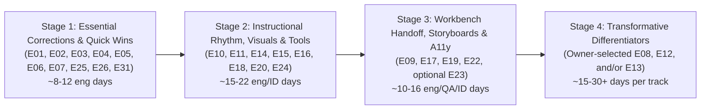

# Implementation Blueprint — CARANA E-Learning (Next Run Planning)

**Prepared:** 18 November 2026
**Baseline Commit:** `aff6ab0c003995a0b2382bb04c8083359ae81597` (`codex/cbd-instructional-run02`)
**Status:** Design blueprint only — awaiting owner approval before any code or content implementation.

---

## 1. Guiding Architecture & Non-Regression Principles

1. **Preserve the Protected Core:**
   - Do **not** alter `module1.html`–`module6.html`, `CARANA_CBD_Group_Activity.html`, `js/storage/lab-storage.js`, or `js/modules/module1.js`–`module6.js`.
   - Keep Lesson 1's 18 locked MP3s (`tools/narration-lock.json`), 3 cinematic JPEGs, and `course/lesson1-data.js` / `course/lesson1-experience.js` untouched unless the owner explicitly approves optional Lesson 1 additions (`E16` option-feedback parity or `E23` bounded evidence note).
   - Keep `cbd.maissara.tech` and `e-learning.maissara.tech` production aliases untouched until explicit owner promotion.
2. **Maintain Storage Namespace Isolation with Clean Adapters:**
   - `carana_cbd_lab_v1` (Original Workbenches), `carana_cbd_course_v1` (Lesson 1), and `carana_learning_v1` (Platform Lessons 2–6) remain separate keys.
   - Cross-surface features (`E04` Lesson 1 progress display on the catalog; `E09` Lesson-to-Workbench handoff) must use **read-only adapters** or **explicit user-confirmed copy actions** with dry-run previews.

---

## 2. Recommended Phased Implementation Sequence

We recommend executing approved enhancements in **four controlled stages** so that essential navigation and data-safety fixes land and pass verification first, before structural UI/pedagogical upgrades or transformative multi-lesson features.



---

## 3. Stage-by-Stage Technical Specifications

### Stage 1 — Essential Corrections, Data Safety & Quick Wins (`E01`–`E07`, `E25`, `E26`, `E31`)

#### 1.1 Unify Navigation & Catalog Progress (`E01`, `E04`)
- **Files:** `course/app.js`, `platform/platform.js`, `platform/catalog.js`, `tools/validate-content.cjs`.
- **Design:**
  - In `course/app.js`:
    - Add a top-level return link in the Lesson 1 header (`#back-home` or adjacent `← CBD Catalog` link) and in the Activities Hub (`/course/#activities`) that navigates cleanly to `../platform/?course=cbd` when `/platform/` is present, while preserving `#home` (`renderHome()`) for standalone Lesson 1 review.
    - On `/course/#home` (`CURRICULUM_PHASES`), replace the 5 hardcoded `"Self-paced lesson coming later"` / `"LESSON IN DEVELOPMENT"` labels for Phases 02–06 with accurate review-adaptation links (`../platform/?course=cbd&lesson=cbd-2`..`cbd-6`) and badge `"REVIEW LESSON AVAILABLE"`.
  - In `platform/platform.js` (`catalogHTML`):
    - Add a read-only helper `readLesson1Summary()` that inspects `localStorage.getItem('carana_cbd_course_v1')` safely (without writing to it) and renders Lesson 1's actual state (`Not started`, `In progress · X / 6 checkpoints`, or `Completed · 6 / 6 checkpoints + workbench confirmed`).
    - For Lessons 2–6, distinguish `Explore lesson` (never opened), `Resume: <Section Title> · X / Y checkpoints` (in progress), and `Review completed lesson · Y / Y checkpoints` (all sections passed).

#### 1.2 Preserve Drafts Across Version Upgrades (`E02`, `E25`)
- **Files:** `platform/platform.js`, `platform/learning-tools.js`, `tests/platform/learning-tools.cjs`, `tests/platform/browser.cjs`.
- **Schema Migration Specification (`safeProgress` in `platform/platform.js`):**
  ```js
  function sanitizeArchivedDrafts(rawDrafts) {
    if (!rawDrafts || typeof rawDrafts !== 'object' || Array.isArray(rawDrafts)) return {};
    const out = {};
    for (const [screenId, fields] of Object.entries(rawDrafts).slice(0, 20)) {
      if (!/^[0-9]{2}-[0-9]{2}$/.test(screenId) || !fields || typeof fields !== 'object') continue;
      const cleanFields = {};
      for (const [k, v] of Object.entries(fields).slice(0, 10)) {
        if (typeof v === 'string' && v.trim()) cleanFields[k] = v.slice(0, 1200);
        else if (Number.isInteger(v)) cleanFields[k] = v;
      }
      if (Object.keys(cleanFields).length) out[screenId] = cleanFields;
    }
    return out;
  }
  ```
  - Include `drafts: sanitizeArchivedDrafts(raw.drafts)` inside `oldRecord` and retain `p.drafts` on existing `previousProgress` entries (up to 5 versions).
  - In `learningTools.html()` / `mount()`, if the current screen's draft is empty and `state.previousProgress` contains a non-empty archived draft for `screen.id`, display a collapsible `<details class="archived-draft">` panel showing the prior version's text and a button **"Copy into current draft"**.
  - Replace the repetitive per-screen `.version-note` (`E25`) with a compact header badge (`Updated version · Earlier drafts archived`) and a single dismissible summary disclosure.

#### 1.3 Validated Progress Restore (`E03`) & Printable Study Sheet (`E07`)
- **Files:** `platform/platform.js`, `course/app.js`, `platform/platform.css`.
- **Design (`E03`):**
  - Add a **Restore progress** button (`#import-progress`) beside `#export-progress` in `platform/platform.js` (and on the `/platform/?course=cbd` catalog).
  - Selecting a `.json` file parses and validates the payload in memory (checking `version === 1`, valid lesson keys `cbd-2`..`cbd-6`, bounded section/screen integers, and `validDraft` bounds), displays a confirmation summary (`Lesson 2: 2/3 checkpoints, 2 drafts...`) with a choice to **Merge with current browser state** or **Replace**, and offers a one-click backup download of existing state before writing.
- **Design (`E07`):**
  - Add **Print / view study summary** (`#export-study-sheet`) that opens a clean, print-styled view containing all learner-authored builder drafts, classification choices, and self-review questions across Lessons 2–6, clearly marked *"Independent study preparation — not an official UN qualification or facilitator solution key"*.

#### 1.4 Honest Builder Self-Review UI (`E06`, `E26`) & Mobile/CLS Fixes (`E05`, `E31`)
- **Files:** `platform/learning-tools.js`, `platform/platform.css`, `platform/index.html`, `curricula/cbd/*.json`.
- **Design (`E06` + `E26`):**
  - Change `#lab-check` label from `"Review my draft"` to **"Open self-review prompts"**.
  - Change `#lab-feedback` class on builder completion from `.feedback` (green success) to `.feedback.self-review` (neutral teal/slate border with clear self-check checklist items per field).
  - Add a live character counter (`0 / 1200` or shown when `>= 900` chars) below each `<textarea>`.
- **Design (`E05` + `E31`):**
  - At `@media (max-width: 900px)`, render `<article class="screen">` first in visual order (or collapse `<aside class="rail">` into a `<details class="mobile-rail-disclosure">` summary bar showing `Lesson X · Section Y of Z · A/B checkpoints`) so `<h1>` is immediately visible at the top of the viewport (`<= 220px` instead of `785px`).
  - Set `#app { min-height: 75vh; }` and render a static header/skeleton in `platform/index.html` so cold-cache CLS drops from `0.378` to `<= 0.02`.

---

### Stage 2 — Instructional Rhythm, Relational Diagrams, Tool Depth & Demo (`E10`, `E11`, `E14`, `E15`, `E16`, `E18`, `E20`, `E24`)

1. **Three-Pattern Screen Layout & Heading Deduplication (`E10`, `E20`, `E24`):**
   - Give each screen in `curricula/cbd/*.json` a distinct `visual.title` that names the specific analytical relationship rather than repeating `screen.title` (`h1`), enforced by `tools/validate-content.cjs` (`E24`).
   - Introduce `screen.layoutPattern` (`"explain" | "investigate" | "construct"`) in `platform/platform.js` so construction and classification screens lead with the active task and avoid stacking redundant widgets.
   - Format `.screen .status` source citations (`E20`) as `Source: UNPOL CBD Lesson X (July 2023), pp. Y–Z` with a `<details>` disclosure for exact file/SHA-256 provenance.
2. **Relational Framework Visualizations (`E11`):**
   - Upgrade `03-10` to an interactive 4-column logframe row diagram (`Result → Measure → Evidence Source → External Assumption`) where selecting a column highlights horizontal mismatches.
   - Upgrade `02-01` to a connected justice-system flow (`Police output → Prosecution → Courts → Corrections / Oversight`).
   - Upgrade `04-05` / `04-07` to an iterative loop diagram with an explicit return arrow from *Monitor/Assess* to *Redefine Problem*.
   - Upgrade `06-03` to a 4-pillar interdependent balance diagram.
3. **Priority & Risk Tool Enhancements (`E14`, `E15`):**
   - In `platform/learning-tools.js` (`rank` on `02-03`): detect when all weights are `0` (`"All weights are set to 0 — assign weights to compare trade-offs"`) and explicitly label tied totals (`"Tied at X weighted points — examine the prerequisite constraint to sequence"`).
   - On `03-06`: add a response-strategy selector (*Preventive action*, *Impact mitigation*, *Contingency trigger*) that explains how each strategy acts on likelihood vs consequence and links directly to the `03-07` contingency builder.
4. **Checkpoint Retrieval & Justification (`E16`) and Bounded Institutional Demo (`E18`):**
   - Add `optionFeedback` arrays to Lesson 1's 36 quiz items (`course/lesson1-data.js`) and a brief retry reflection prompt on missed questions.
   - Update `platform/demo.html` (`E18`) so selecting Run 02 demonstrations loads isolated, ungated interactive previews (`02-03` Priority Lab, `02-04` SMART Builder, `03-10` Logframe Row) rather than embedding the full gated Lesson 2 app inside a `750px` iframe.

---

### Stage 3 — Workbench Handoff, Storyboard Differentiation & Assistive-Tech Acceptance (`E09`, `E17`, `E19`, `E22`, `E23`)

1. **Reviewable Workbench Handoff (`E09`) & Preparation Checklist (`E19`):**
   - On lesson completion screens (`02-06`, `03-07`, `04-06`, `05-05`, `06-06`), render a **Workbench Handoff Card** showing the learner's drafted fields alongside the target `moduleX.html` stage and an opt-in **"Stage draft notes for Module X"** button with a diff preview.
   - Display a non-graded **Preparation Checklist** (`E19`: *Concepts explored · Practice draft written · Self-review opened · Ready for workbench*).
2. **Storyboard Differentiation (`E17`):**
   - Rewrite the duplicated `teachingPrompt` strings across Lessons 3, 4, 5, and 6 in `curricula/cbd/*.json` so all 14 artwork specifications pose a unique, screen-specific observational question and depict distinct operational settings before any image generation is quoted (`E30`).
3. **Assistive-Technology & Physical-Device Acceptance (`E22`):**
   - Change `02-03` `#priority-result` live region updates from `oninput` to `onchange` (or debounce) so VoiceOver does not queue intermediate numbers while dragging sliders, and execute a documented macOS/iOS VoiceOver + keyboard acceptance checklist.

---

### Stage 4 — Transformative Differentiators (`E08`, `E12`, `E13` — Subject to Separate Owner Selection)

- **Track A (`E08`):** Connected Evidence-to-Decision Notebook (`carana_learning_v1.notebook`) linking Lesson 1 → Lesson 6 drafts into a single cross-lesson advisory thread.
- **Track B (`E12`):** Criterion-tagged Self / Peer / Facilitator Reasoning Rubric with Version 1 → Version 2 draft comparison.
- **Track C (`E13`):** Evolving Professional Case with two mid-course evidence updates and two defensible advisory paths.

---

## 4. Verification Gates for Any Future Implementation Run

Every implementation batch must pass:
1. `node tools/validate-content.cjs` (including new cross-route, unique prompt, and heading deduplication assertions).
2. `npm test` (all 65 original workbench tests + 32 Lesson 1 smoke assertions + build-integrity byte guards + new version-migration and import-restore negative tests).
3. `npm run release:prepare` (clean 72+ file static artifact, zero `.pdf`/`.env`/`docs` leakage).
4. Full 3-profile Playwright journeys (`chromium`, `webkit-desktop`, `webkit-mobile`) + `tests/platform/layout.cjs` (`320px`/`768px` LTR/RTL) + `performance-probe.cjs` (confirming `/platform/?course=cbd` cold-cache CLS `<= 0.1` and mobile `<h1>` lead distance `<= 250px`).
